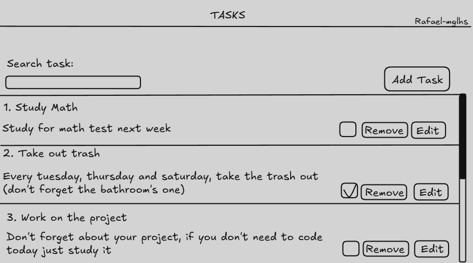
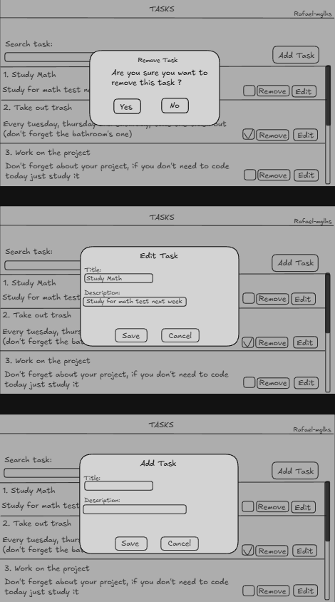

<!-- HERO -->
<div align="center">
  <h1>🚀 ToDo List & ToDo WPF</h1>
  <p><strong>A modern task and daily routine manager built with .NET 10, featuring a native WPF desktop interface, real-time search, and local JSON persistence.</strong></p>

  <p>
    <a href="https://img.shields.io/badge/.NET-10.0-512BD4"></a>
    <a href="https://img.shields.io/badge/WPF-Desktop_GUI-0078D7"></a>
    <a href="https://img.shields.io/badge/System.Text.Json-Serialization-orange"></a>
    <a href="https://img.shields.io/badge/Release-v2.0.0-brightgreen"></a>
    <a href="LICENSE"></a>
    <a href="https://github.com/Rafael-mglhs/ToDoList/commits/main"></a>
  </p>
  
  <p>
    <a href="#-about--overview">About</a> •
    <a href="#-visual-preview">Visual Preview</a> •
    <a href="#-tech-stack">Tech Stack</a> •
    <a href="#-key-features">Features</a> •
    <a href="#-getting-started">Getting Started</a> •
    <a href="#-project-structure">Project Structure</a> •
    <a href="#-roadmap">Roadmap</a> •
    <a href="#-author">Author</a>
  </p>
</div>

---

## 📌 About & Overview

**ToDo List & ToDo WPF** is a task and routine management application built in **.NET 10**. It started as a clean console application and has evolved into a full desktop GUI application using **WPF (Windows Presentation Foundation)**.

### The Problem It Solves
When tracking daily habits and recurring routines (such as study sessions, workout routines, or daily checklists), conventional to-do apps introduce friction:
1. **Manual Reset Burden**: You often have to manually uncheck or recreate recurring tasks each day.
2. **Heavyweight Solutions**: Cloud-based web tools consume excessive resources and require an internet connection for basic personal task tracking.

### The Solution
**ToDoWpf (v2.0.0)** provides a lightweight, local-first desktop experience:
- **Automated Daily Reset**: Tasks marked as complete automatically reset their completion status the next day based on their completion date (`Date`), making routine and habit tracking effortless.
- **Dynamic Real-Time Search**: Filters your tasks instantly as you type in the search bar.
- **Dedicated Modal Dialogs**: Dedicated windows for creating and editing tasks, pre-filling current data when editing to prevent typos.
- **Defensive Confirmation**: Prompts for confirmation before deleting tasks to avoid accidental data loss.
- **Safe Persistence**: Stores data atomically in `%LOCALAPPDATA%\ToDoWpf\tasks.json`, ensuring compliance with Windows file permission guidelines.

---

## 🖼️ Visual Preview

<div align="center">
  <table width="100%">
    <tr>
      <td width="50%" align="center">
        <h4>Main Window & Reactive Task List</h4>
        
        <p><em>Real-time search bar, dynamic task cards, completion toggles, edit and delete buttons.</em></p>
      </td>
      <td width="50%" align="center">
        <h4>Add & Edit Modal Windows</h4>
        
        <p><em>Centered modal dialogs with state preservation for editing and creating tasks.</em></p>
      </td>
    </tr>
  </table>
</div>

---

## 🛠️ Tech Stack

| Technology | Purpose |
| :--- | :--- |
| **.NET 10** | Modern runtime environment powering both the desktop and console projects. |
| **WPF (Windows Presentation Foundation)** | Native Windows desktop GUI framework providing hardware-accelerated rendering and declarative XAML layouts. |
| **System.Text.Json** | High-performance, zero-dependency JSON serialization for reading and writing saved tasks with indentation. |
| **LocalApplicationData** | Uses `Environment.SpecialFolder.LocalApplicationData` (`%LOCALAPPDATA%\ToDoWpf`) to store task data safely without requiring elevated permissions. |

---

## ✨ Key Features

| Feature | Console (v1.0) | Desktop WPF (v2.0) | Benefit |
| :--- | :--- | :--- | :--- |
| **User Interface** | Terminal menu navigation | Native desktop window with responsive cards | Intuitive and visual interaction. |
| **Search** | Exact match / index input prompt | Instant live filtering on keystroke (`TextChanged`) | Real-time feedback with zero waiting. |
| **Routine Management** | Static completion status | **Daily Auto-Reset** based on task date | Eliminates manual unchecking for daily habits. |
| **Task Editing** | Re-typing fields from scratch | Modal dialog pre-filled with current title & description | Faster updates and context retention. |
| **Task Deletion** | Immediate deletion by index | **Confirmation Prompt** (`MessageBox` Yes/No) | Prevents accidental data loss. |
| **Data Storage** | Local directory | Standard `%LOCALAPPDATA%\ToDoWpf\tasks.json` | Complies with OS standards and avoids permission errors. |

---

## 🚀 Getting Started

### Prerequisites
- [.NET 10.0 SDK](https://dotnet.microsoft.com/download) installed.
- **Windows 10 or 11** (required to run the WPF desktop application).
- [Git](https://git-scm.com/) installed.

### 1. Clone the Repository
```bash
git clone https://github.com/Rafael-mglhs/ToDoList.git
cd ToDoList
```

### 2. Build the Solution
```bash
dotnet build
```

### 3. Run the Application

#### Desktop Application (WPF - Recommended)
```bash
dotnet run --project ToDoWpf
```

#### Console Application (CLI)
```bash
dotnet run --project ToDoList
```

---

## 📂 Project Structure

```text
ToDoList/
├── docs/
│   └── wireframes/
│       ├── main-page.png                  # Main window screenshot
│       └── features-screeens.png          # Add and Edit modal screenshots
├── ToDoList/                              # Core logic & Console project (.NET 10)
│   ├── Data/
│   │   └── tasks.json                     # Sample task data
│   ├── Helpers/
│   │   └── InputValidator.cs              # Input sanitization and validators for CLI
│   ├── Models/
│   │   └── TaskItem.cs                    # Domain entity (Title, Description, Complete, Date)
│   ├── Services/
│   │   ├── JsonService.cs                 # JSON persistence service in %LOCALAPPDATA%
│   │   └── TaskService.cs                 # Business logic for task operations
│   ├── Program.cs                         # Console entry point
│   └── ToDoList.csproj                    # Console project definition
├── ToDoWpf/                               # Desktop GUI project (WPF .NET 10)
│   ├── AddTaskWindow.xaml                 # Add task modal dialog
│   ├── AddTaskWindow.xaml.cs              # Add task code-behind logic
│   ├── Edit.xaml                          # Edit task modal dialog
│   ├── Edit.xaml.cs                       # Edit task code-behind logic with pre-filled inputs
│   ├── MainWindow.xaml                    # Main window layout (cards, live search, scroll view)
│   ├── MainWindow.xaml.cs                 # Main window code-behind (events and daily reset)
│   ├── App.xaml / App.xaml.cs             # Application startup and lifecycle
│   └── ToDoWpf.csproj                     # WPF project definition referencing ToDoList
├── CHANGELOG.md                           # Detailed version history (Keep a Changelog)
├── README.md                              # Project documentation
└── ToDoList.sln                           # Solution file
```

---

## 🗺️ Roadmap

- [x] **v1.0.0 — Console Version (CLI)**: Complete CRUD, input validation, search, and JSON persistence.
- [x] **v2.0.0 — Desktop Version (WPF)**: Native GUI, live search filter, modal windows, automated daily routine reset, and `%LOCALAPPDATA%` persistence.
- [ ] **v2.1.0 — MVVM & UI Refinements**:
  - Full MVVM pattern implementation (`CommunityToolkit.Mvvm`).
  - Dark/Light theme support inspired by the Dracula color scheme.

---

## 📄 Changelog

For a detailed list of all changes, improvements, and fixes across versions, check out [CHANGELOG.md](CHANGELOG.md).

---

## 👨‍💻 Author

<table align="center">
  <tr>
    <td align="center">
      <a href="https://github.com/Rafael-mglhs">
        <br />
        <sub><b>Rafael Magalhães</b></sub>
      </a>
      <br /><br />
      <a href="https://github.com/Rafael-mglhs" title="GitHub"></a>
      <a href="https://www.linkedin.com/in/rafael-magalhães-9958b9403" title="LinkedIn"></a>
      <a href="mailto:rafaelsouzamagalhaes08@gmail.com" title="Email"></a>
    </td>
  </tr>
</table>
